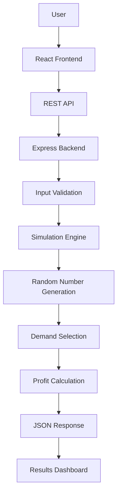

# NewsLab – Newspaper Seller Problem Simulation

A full-stack web application for simulating the Newspaper
Seller Problem using probability distributions, random
number generation, and Monte Carlo simulation.

Developed as an academic project for **CSE 424:
Simulation & Modeling Sessional**.

---

## Project Overview

The Newspaper Seller Problem is a classical simulation
problem used to determine a profitable newspaper order
quantity under uncertain daily demand.

A newspaper seller must decide how many newspapers to
purchase each day without knowing the actual customer demand.

Ordering too many newspapers may result in unsold inventory,
while ordering too few may result in lost sales opportunities.

This application simulates daily demand, calculates profit,
and compares different order quantities to support
decision-making.

---

## Objectives

- Simulate daily newspaper demand using probability distributions.
- Calculate daily revenue, purchase cost, lost profit,
  salvage value, and total profit.
- Analyze financial performance over multiple simulated days.
- Compare different newspaper order quantities.
- Identify the most profitable order quantity among
  the tested alternatives.
- Demonstrate frontend and backend integration.

---

## Features

- Professional and responsive dashboard.
- Configurable simulation parameters.
- Monte Carlo simulation.
- Seed-based random number generation.
- Reproducible simulation results.
- Six-decimal random number precision.
- Accurate probability boundary selection.
- Financial performance summary.
- Day-wise simulation result table.
- Good, Fair, and Poor day distribution.
- Order quantity comparison chart.
- Probability distribution tables.
- Input validation and API error handling.
- Automated backend testing.

---

## Technology Stack

| Layer | Technology |
|---|---|
| Frontend | React.js |
| Frontend Build Tool | Vite |
| Styling | Tailwind CSS |
| Backend | Node.js |
| Backend Framework | Express.js |
| Programming Language | JavaScript |
| Chart Visualization | SVG |
| Communication | REST API |
| Testing | Node.js Test Runner |
| Version Control | Git and GitHub |

---

## System Architecture



---

## Project Structure

```text
newspaper-sim/
│
├── client/
│   ├── src/
│   │   ├── components/
│   │   │   ├── InputForm.jsx
│   │   │   ├── Summary.jsx
│   │   │   ├── ResultTable.jsx
│   │   │   ├── CompareChart.jsx
│   │   │   └── ModelData.jsx
│   │   │
│   │   ├── App.jsx
│   │   ├── api.js
│   │   ├── index.css
│   │   └── main.jsx
│   │
│   ├── index.html
│   ├── vite.config.js
│   ├── tailwind.config.js
│   ├── postcss.config.js
│   └── package.json
│
├── server/
│   ├── src/
│   │   ├── index.js
│   │   ├── routes.js
│   │   └── simulation.js
│   │
│   ├── test/
│   │   └── simulation.test.js
│   │
│   └── package.json
│
├── .gitignore
├── package.json
└── README.md
```

---

## Application Workflow

1. The user enters the simulation parameters.
2. The frontend sends the parameters to the backend.
3. The backend validates the input values.
4. Two random numbers are generated for each simulated day.
5. The first random number determines the day type.
6. The second random number determines newspaper demand.
7. Revenue, expenses, and daily profit are calculated.
8. The backend returns the simulation results to the frontend.
9. The frontend displays the results using summary cards,
   tables, and charts.
10. The user can compare different order quantities.

---

## Default Simulation Parameters

| Parameter | Default Value |
|---|---:|
| Order Quantity | 70 newspapers |
| Simulation Days | 20 days |
| Purchase Cost | $0.33 |
| Selling Price | $0.50 |
| Scrap Value | $0.05 |
| Random Seed | Optional |

All monetary values are expressed in USD.

---

## Probability Model

### 1. Day Type Distribution

| Day Type | Probability | Cumulative Probability |
|---|---:|---:|
| Good | 0.35 | 0.35 |
| Fair | 0.45 | 0.80 |
| Poor | 0.20 | 1.00 |
| **Total** | **1.00** | |

### 2. Conditional Demand Distribution

Newspaper demand depends on the selected day type.

| Demand | Good | Fair | Poor |
|---:|---:|---:|---:|
| 40 | 0.03 | 0.10 | 0.44 |
| 50 | 0.05 | 0.18 | 0.22 |
| 60 | 0.15 | 0.40 | 0.16 |
| 70 | 0.20 | 0.20 | 0.12 |
| 80 | 0.35 | 0.08 | 0.06 |
| 90 | 0.15 | 0.04 | 0.00 |
| 100 | 0.07 | 0.00 | 0.00 |
| **Total** | **1.00** | **1.00** | **1.00** |

### 3. Random Number Intervals

| Day Type | Random Number Interval |
|---|---|
| Good | 0.000000 – 0.349999 |
| Fair | 0.350000 – 0.799999 |
| Poor | 0.800000 – 0.999999 |

---

## Mathematical Model

Let:

- Q = Order quantity
- D = Daily newspaper demand
- C = Purchase cost per newspaper
- P = Selling price per newspaper
- S = Scrap value per newspaper

### Newspapers Sold

```text
Sold = min(Q, D)
```

### Unsold Newspapers

```text
Unsold = max(Q - D, 0)
```

### Unmet Demand

```text
Shortage = max(D - Q, 0)
```

### Sales Revenue

```text
Revenue = Sold × P
```

### Purchase Cost

```text
Purchase Cost = Q × C
```

### Lost Profit

```text
Lost Profit = Shortage × (P - C)
```

### Salvage Value

```text
Salvage Value = Unsold × S
```

### Daily Profit

```text
Daily Profit = Revenue
             - Purchase Cost
             - Lost Profit
             + Salvage Value
```

### Total Profit

```text
Total Profit = Sum of all daily profits
```

### Average Daily Profit

```text
Average Daily Profit = Total Profit / Simulation Days
```

The profit formula follows the classical newspaper seller
simulation model, where lost profit from unmet demand is
treated as an opportunity-cost adjustment.

---

## Simulation Algorithm

```text
START

Input simulation parameters
Initialize random number generator
Initialize financial totals

FOR each simulation day:

    Generate random number RN1
    Determine day type using RN1

    Generate random number RN2
    Determine demand using RN2 and day type

    Calculate newspapers sold
    Calculate unsold newspapers
    Calculate unmet demand

    Calculate revenue
    Calculate purchase cost
    Calculate lost profit
    Calculate salvage value
    Calculate daily profit

    Store daily result
    Update financial totals

END FOR

Calculate total profit
Calculate average daily profit

Return simulation results

END
```

---

## Order Quantity Comparison

The application compares the following daily order quantities:

```text
40, 50, 60, 70, 80, 90, 100
```

All order quantities within a comparison run use the same
random demand sequence and simulation parameters.

This common random numbers approach ensures that differences
in profit are caused by changes in order quantity rather
than different sampled demand sequences.

The order quantity with the highest simulated total profit
is identified as the best tested order size.

The result is specific to the selected simulation period
and random seed. It does not guarantee a globally optimal
order quantity.

---

## Random Seed and Reproducibility

A random seed controls the pseudo-random number generator.

Running the simulation with the same seed and identical
parameters produces the same results.

If the seed is left empty, the backend automatically
generates a seed and includes it in the response.

This allows the generated simulation to be reproduced later.

---

## Installation and Setup

### Prerequisites

Make sure the following software is installed:

- Node.js
- npm
- Git (optional)

Node.js 22 is recommended.

### Step 1: Open the Project

Open the project root directory in a terminal.

```bash
cd newspaper-sim
```

### Step 2: Install Dependencies

```bash
npm install
```

This installs the dependencies for both the frontend
and backend using npm workspaces.

### Step 3: Start the Application

```bash
npm run dev
```

### Step 4: Open the Application

Frontend:

```text
http://localhost:5173
```

Backend:

```text
http://localhost:3001
```

Both servers run concurrently in development mode.

---

## Available Commands

| Command | Description |
|---|---|
| `npm install` | Install all project dependencies |
| `npm run dev` | Start frontend and backend |
| `npm run build` | Build the frontend for production |
| `npm start` | Build and run the production application |
| `npm test` | Run backend automated tests |
| `npm test -w server` | Run server workspace tests |

---

## Production Mode

To build and start the production application:

```bash
npm start
```

The Express server serves both the REST API and the
built React frontend.

Open:

```text
http://localhost:3001
```

---

## REST API Endpoints

| Method | Endpoint | Description |
|---|---|---|
| GET | `/api/health` | Check backend server status |
| GET | `/api/config` | Retrieve model configuration |
| POST | `/api/simulate` | Run newspaper simulation |
| POST | `/api/compare` | Compare order quantities |

### Example Simulation Request

Endpoint:

```text
POST /api/simulate
```

Request body:

```json
{
  "orderSize": 70,
  "days": 20,
  "cost": 0.33,
  "price": 0.50,
  "scrap": 0.05,
  "seed": 42
}
```

The response contains:

- Simulation parameters
- Daily simulation records
- Financial summary
- Day type distribution
- Actual random seed

---

## Input Validation

The backend validates all simulation parameters.

| Parameter | Accepted Range |
|---|---|
| Order Quantity | 0–1000 newspapers |
| Simulation Days | 1–10,000 days |
| Purchase Cost | $0–$1000 |
| Selling Price | $0–$1000 |
| Scrap Value | $0–$1000 |
| Random Seed | 0–4294967295 |


Invalid requests return appropriate JSON error messages.

---

## Backend Testing

The project uses the built-in Node.js test runner.

Test file:

```text
server/test/simulation.test.js
```

Run all tests:

```bash
npm test
```

### Test Cases

| No. | Test Description |
|---:|---|
| 1 | Profit calculation when demand exceeds supply |
| 2 | Profit calculation when supply exceeds demand |
| 3 | Profit calculation when demand equals supply |
| 4 | Probability distributions sum to one |
| 5 | Random seed reproducibility |
| 6 | Consistency between daily and total profit |
| 7 | Valid newspaper demand range |
| 8 | Correct order quantity comparison |
| 9 | Floating-point probability boundary regression test |

Expected result:

```text
Tests: 9
Passed: 9
Failed: 0
```

---

## Current Limitations

- Simulation results depend on the probability model.
- Results vary depending on the random seed and simulation duration.
- Order comparison is limited to seven predefined quantities.
- The result table displays up to the first 500 simulated days.
- Financial summaries include all simulated days.
- Simulation data is not permanently stored in a database.
- The application is intended for academic simulation
  and educational purposes.

---

## Future Scope

- Simulation result export.
- Persistent simulation history.
- Custom probability distributions.
- Custom order quantity comparison ranges.
- Multiple independent simulation replications.
- Expected profit analysis and confidence intervals.

---


## Reference

Banks, J., Carson, J. S., Nelson, B. L., and Nicol, D. M.

*Discrete-Event System Simulation*, Chapter 2.

---

## Conclusion

NewsLab provides an interactive implementation of the
classical Newspaper Seller Problem.

By combining probability-based simulation, random number
generation, financial calculations, and data visualization,
the application demonstrates how simulation techniques can
support decision-making under uncertainty.